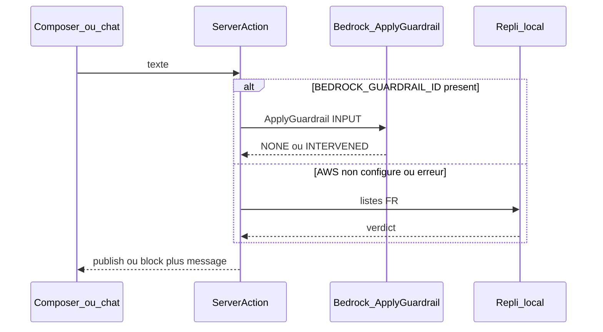

# Modérateur IA (Bedrock Guardrails)

Filtrer posts et messages via Amazon Bedrock Guardrails avant publication. Sans AWS configuré, un repli local applique les mêmes deux refus : « vocabulaire inapproprié » et « contenu sensible ».

## Comportement

Avant tout envoi (post, réponse, message privé), le texte passe par la modération. Rien n’est persisté dans l’état de démo tant que le verdict n’est pas `publish`.

- **Vulgarité / gros mots** → le message reste dans le champ, erreur **« vocabulaire inapproprié »**
- **Autre contenu sensible** (insultes graves, haine, sexuel, violence, conseils médicaux type dose, etc.) → **« contenu sensible »**
- **OK** → envoi inchangé (toast de succès pour un post)

Les identifiants AWS restent **côté serveur** uniquement (pas de `NEXT_PUBLIC_`).



## Brancher AWS (quand le Workshop sera dispo)

1. Console Bedrock → **Guardrails** → créer un guardrail (région `eu-west-3` comme dans [`.env.example`](.env.example)) :
   - **Content filters** : Insults / Hate / Sexual / Violence / Misconduct (seuil moyen)
   - **Denied topics** : conseils médicaux / doses (aligné hors-périmètre du cadrage)
   - **Word filters** : liste gérée **Profanity** + mots FR si besoin
2. Copier l’ID et la version (`DRAFT` ou un numéro) dans `.env.local` :

```
AWS_REGION=eu-west-3
BEDROCK_GUARDRAIL_ID=...
BEDROCK_GUARDRAIL_VERSION=DRAFT
AWS_ACCESS_KEY_ID=...
AWS_SECRET_ACCESS_KEY=...
AWS_SESSION_TOKEN=...
```

3. Appel SDK : `BedrockRuntimeClient` + `ApplyGuardrailCommand` (`source: "INPUT"`, `content: [{ text: { text } }]`). **Pas besoin d’un modèle** : Guardrails filtre le texte tout seul.

Mapping des `assessments` :
- `wordPolicy` (PROFANITY / custom words) ou filtre `INSULTS` → `vocabulaire inapproprié`
- tout autre `GUARDRAIL_INTERVENED` (topics, SEXUAL, HATE, VIOLENCE, PII, etc.) → `contenu sensible`

## Code

**Dépendance** : `@aws-sdk/client-bedrock-runtime`.

**Nouveau module serveur** [`src/lib/moderation/guardrail.ts`](src/lib/moderation/guardrail.ts) :
- `applyGuardrail(text)` → appelle AWS si `BEDROCK_GUARDRAIL_ID` est défini
- `fallbackModerate(text)` → listes FR (gros mots vs motifs sensibles)
- en cas d’erreur réseau / 403, même repli (pour ne pas casser la démo)

**Server Action** [`src/app/actions/moderate.ts`](src/app/actions/moderate.ts) (`"use server"`) pour que le client n’embarque jamais le SDK ni les clés.

**Couche existante** [`src/lib/services/index.ts`](src/lib/services/index.ts) — étendre le verdict (l’UI n’appelle que cette fonction, comme le README) :

```ts
export type ModerationVerdict =
  | { decision: "publish" }
  | { decision: "block"; message: "vocabulaire inapproprié" | "contenu sensible" };

export async function moderateMessage(text: string): Promise<ModerationVerdict>
```

Le corps délègue à la Server Action (signatures stables pour le reste des services IA).

**UI — arrêter l’envoi et afficher l’erreur** (texte conservé pour reformuler) :
- [`src/components/composer-sheet.tsx`](src/components/composer-sheet.tsx) — posts
- [`src/app/(app)/circles/[id]/thread/[tid]/page.tsx`](src/app/(app)/circles/[id]/thread/[tid]/page.tsx) — réponses
- [`src/app/(app)/messages/[id]/page.tsx`](src/app/(app)/messages/[id]/page.tsx) — MP

Dans les 3 flux : `if (verdict.decision === "block")` → set erreur inline + `showToast(verdict.message)` ; sinon `addThread` / `addReply` / `sendChat`. Bouton désactivé pendant l’appel.

**Config** : [`.env.example`](.env.example) + courte note README (création du Guardrail + fallback).

Le back-office [`/moderation`](src/app/(admin)/moderation/page.tsx) reste une maquette (cas types hardcodés) : hors scope de ce filtre avant publication.

## Vérif

Sans AWS : poster un gros mot → bloqué ; phrase neutre → publié ; dose type « 10 mg » → contenu sensible. Avec AWS : même parcours une fois les vars renseignées.

## Tâches

- [ ] Ajouter `@aws-sdk/client-bedrock-runtime` et variables `BEDROCK_GUARDRAIL_*` dans `.env.example`
- [ ] Module serveur ApplyGuardrail + mapping des assessments + repli local FR
- [ ] Server Action + étendre `moderateMessage` (`publish` | `block`)
- [ ] Composer, réponses et MP : ne pas envoyer, afficher l’erreur, garder le texte
- [ ] Vérifier les 3 flux (neutre / vulgarité / sensible) dans le navigateur
